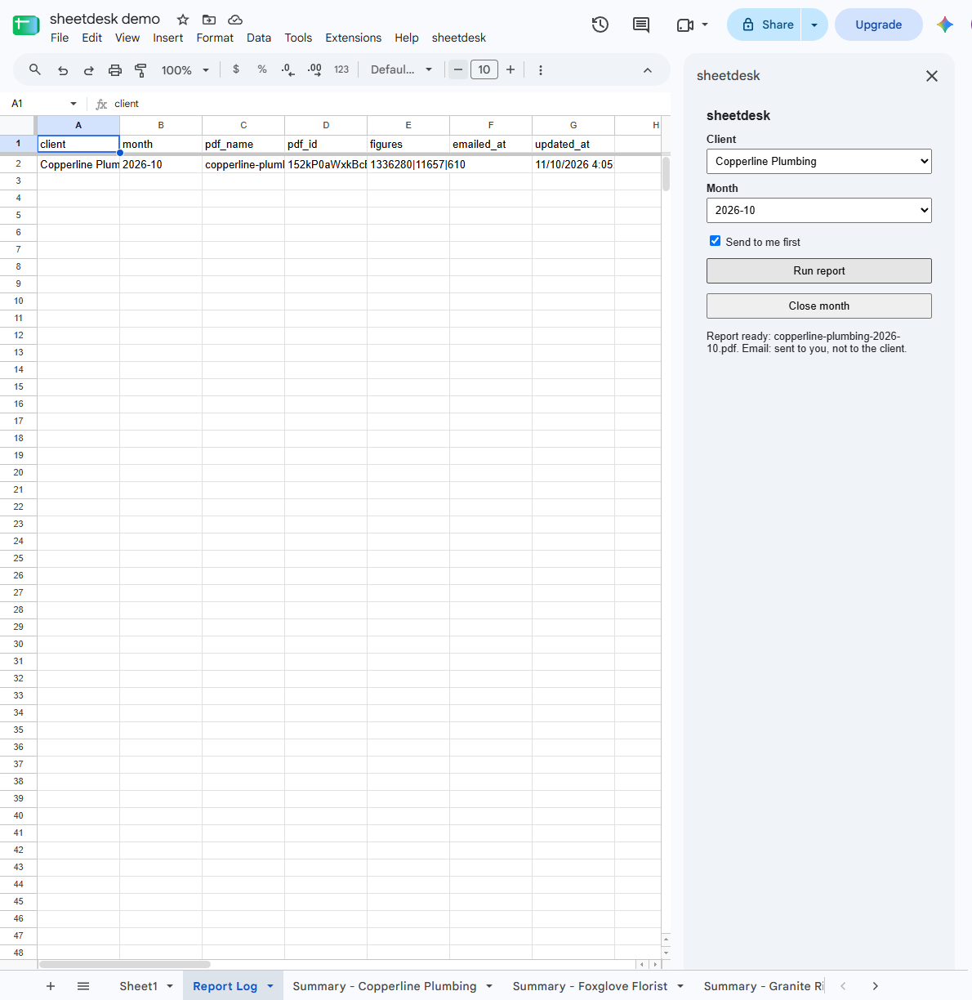
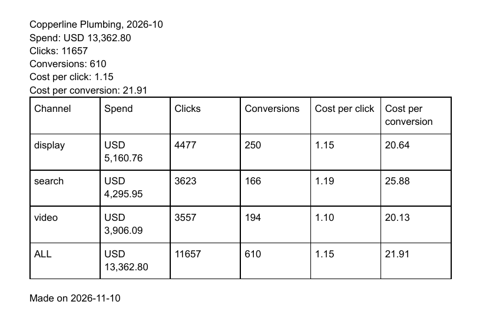
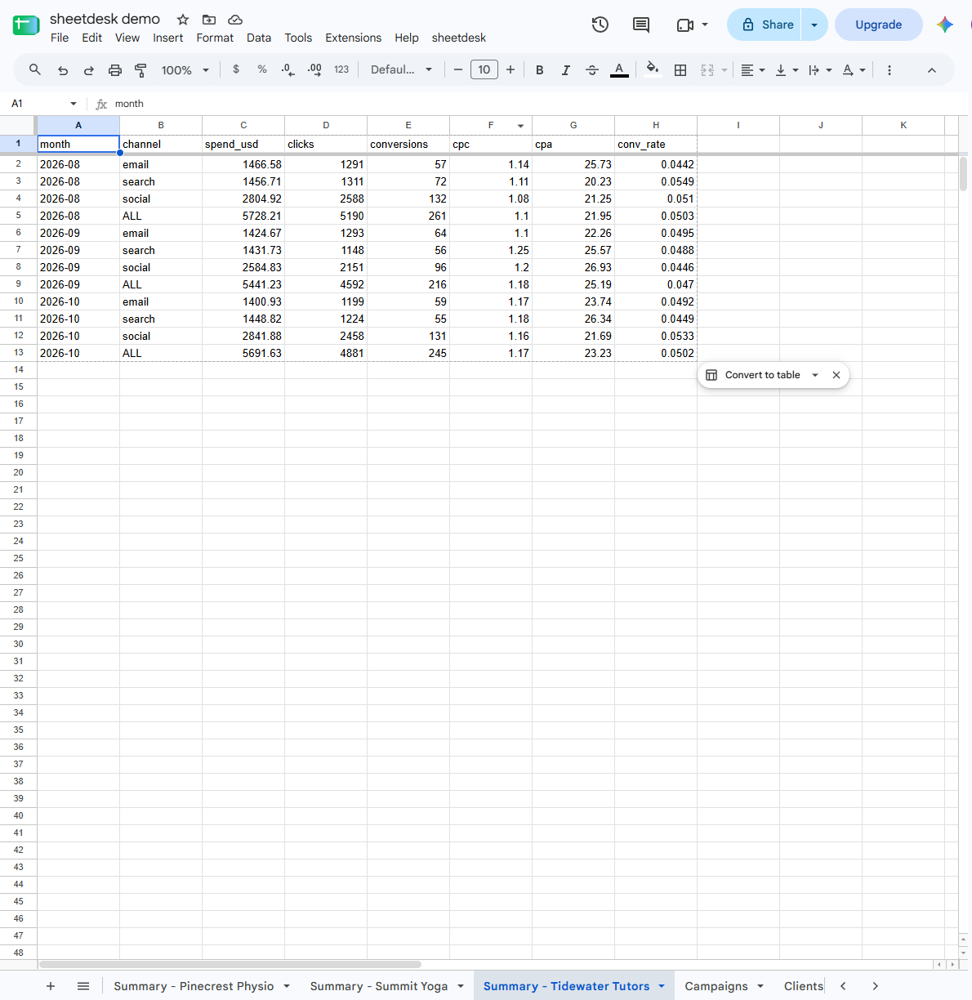
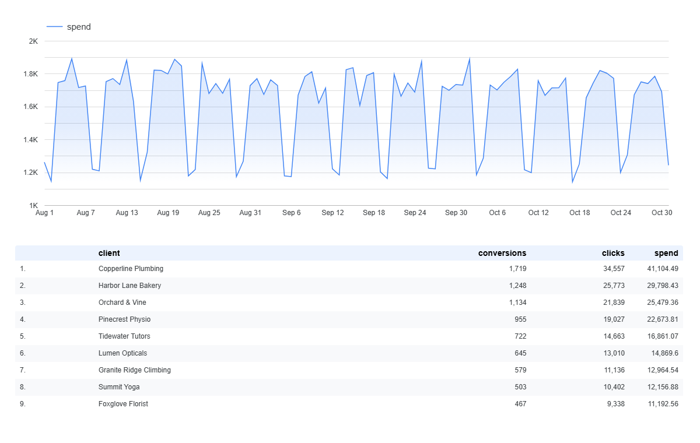
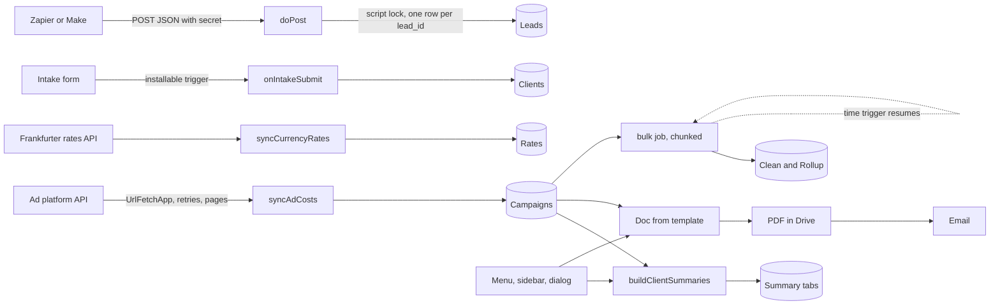

# sheetdesk

Google Apps Script tools that run a small marketing agency out of one Sheet.

[](https://github.com/Exalt24/sheetdesk/actions/workflows/ci.yml)



*A real Google Sheet on 2026-11-10 after Run report: the sidebar says the report is ready and the email went to the person running it, not the client. The Report Log row is behind it.*



*The PDF that arrived by email. Its figures match `fixtures/campaigns.csv`. What ran is in [docs/live-run.md](docs/live-run.md).*



*The Summary tab that Rebuild summaries wrote for Tidewater Tutors.*



*A Data Studio (Looker Studio) report on the same Sheet, built by hand in the editor and shared by link: [open the report](https://datastudio.google.com/reporting/e3ad4a80-d1d2-47cb-bdfd-20df33d35874). Its figures match the Summary and Campaigns tabs. How it was built: [docs/live-run.md](docs/live-run.md).*

## What it does

A small agency repeats the same chores every month. Add up each client's ad spend, build a report, email it, and keep new leads and new clients in the right place. sheetdesk does these chores from one Google Sheet.

- **Reports.** Pick a client and a month in a sidebar and get a PDF report. Tick "Send to me first" and the PDF comes to you. Check it, then untick the box and send it to the client.
- **Month close.** One button builds a report for every active client. A client is not emailed the same figures twice.
- **Summaries.** One tab per client with spend, clicks, conversions, cost per click and cost per conversion, by month and channel. Money in euros or pounds is converted to dollars with the rate of the day.
- **Leads.** Zapier or Make posts new leads to a web address. Each lead lands in the Leads tab once, even when Zapier retries.
- **New clients.** A Google Form collects a client's details, adds a row to the Clients tab and sends a confirmation.
- **Ad costs and rates.** Pull daily ad costs and currency rates into the Sheet.
- **Big sheets.** Clean and roll up 50,000 rows inside Google's 6 minute limit, in several runs.

A made-up agency, Fernwood Digital, runs on it: nine invented clients, 2,024 generated campaign rows and 300 generated leads.

**Ready to use for:** trying on a copy of a Sheet. On 2026-11-10 the menu, Set up, the summaries, the sidebar report with its PDF and the web app ran on a real Google account ([what ran](docs/live-run.md)). Month close, the form trigger and the bulk job did not. See [Limits](#limits).

## Why it exists

A script that works once when you click it is not a tool. Here each chore is a module that is safe to run twice, checks its input, and has tests. Everything runs on invented data from a seeded generator. There are no real clients, no real people and no secrets in the repo.

## How it works



Apps Script loads every file in `src/` into one global scope, so the modules call each other by function name. A trailing underscore marks a private function, which `google.script.run` cannot call.

## The pieces

| Piece | What it does | Page |
|---|---|---|
| Summaries, PDFs, month close | One summary tab per client from one `getValues`. A monthly report built from a template Doc, exported to a PDF with a stable name (a rerun replaces it), and emailed. | [summaries-and-pdfs.md](docs/summaries-and-pdfs.md) |
| Menu, sidebar, dialog | `onOpen` menu, a sidebar with a client picker, a confirm dialog for the month close. Server functions check their input. | [menu-and-sidebar.md](docs/menu-and-sidebar.md) |
| Web app | `doPost` lead webhook with a shared secret, bad JSON and unknown field errors, one row per `lead_id` under a lock. `doGet` status JSON or an HTML dashboard. | [webhook.md](docs/webhook.md) |
| Intake form | An installable `onFormSubmit` trigger writes a client row and sends a confirmation. | [intake-form.md](docs/intake-form.md) |
| Ad costs and rates | A `UrlFetchApp` client with backoff, `Retry-After`, pagination and a response check. Pulls daily ad costs and USD rates. | [ad-and-fx.md](docs/ad-and-fx.md) |
| Scale | 50,000 rows in chunks, a time budget, a saved cursor and a continuation trigger. | [scale.md](docs/scale.md) |
| Fake and data | The local fake of Google's services, and the seeded generator behind every number here. | [fake-and-seed.md](docs/fake-and-seed.md) |
| Running it | Add a client, a channel or a column, rename the agency, read the logs, roll a version, fix a stopped trigger, and why each permission is asked for. | [maintenance.md](docs/maintenance.md) |

## Deploy with clasp

You need a Google account, Node 24 and `clasp`, Google's command line tool for Apps Script. The first part of these steps (clasp create, push and a deployment) was run on 2026-11-10 and is recorded in [docs/live-run.md](docs/live-run.md).

1. Switch on the Apps Script API for your account at [script.google.com/home/usersettings](https://script.google.com/home/usersettings). clasp cannot push without it.
2. Install clasp and sign in. The sign in opens a browser.

   ```bash
   npm install -g @google/clasp
   clasp login
   ```

3. Make a new Google Sheet. In it choose Extensions, then Apps Script. This makes the script that belongs to the Sheet. In the editor open Project settings (the gear) and copy the Script ID.
4. Put the id in `.clasp.json`, which already sets the folder and the file order. Do not commit your id.

   ```json
   {
     "scriptId": "PASTE_THE_SCRIPT_ID_HERE",
     "rootDir": "src",
     "filePushOrder": ["src/Config.js", "src/Util.js"]
   }
   ```

5. Upload the code. If clasp asks whether to overwrite the manifest, answer yes, because `src/appsscript.json` is the one to keep.

   ```bash
   clasp push
   ```

6. Reload the Sheet. A **sheetdesk** menu appears. Choose **sheetdesk**, then **Set up**. This creates the Campaigns, Clients, Leads and Rates tabs and saves a random webhook secret in the script properties. The first time, Google asks for permission:

   - Google shows "Google hasn't verified this app", because the script has not been submitted for Google's review. You deployed it yourself, so choose Advanced, then Go to the project, then Allow.
   - The permissions are one line each. Spreadsheets: read and write the Sheet. Documents: build the report from a template Doc. Drive: save the PDF and trash the working copy. Send mail: email the report. Forms: create the intake form. External requests: call the ad platform and the rates API. Triggers: run the intake form and the bulk job. Menus and sidebars: show the menu and sidebar. Email address: find your address for "Send to me first". The table in [maintenance.md](docs/maintenance.md) says which call needs each one.

7. Load the sample data. In the Sheet open the **Clients** tab, click cell A1, then File, Import, Upload, choose `fixtures/clients.csv`, set the import location to "Replace data at selected cell", leave the option that converts text to numbers and dates ticked (the code reads real dates), and import. Do the same with `fixtures/campaigns.csv` on the **Campaigns** tab and `fixtures/rates.csv` on the **Rates** tab. `node scripts/seed.js` rewrites the fixtures. The leads file is not imported, because leads arrive through the webhook.
8. Make the intake form. In the Sheet choose Extensions, then Apps Script to open the editor. Pick `installIntakeTrigger` in the function list at the top and press Run. Accept the permission screen. When it finishes, the execution log at the bottom shows the form link. Open that link to see the form.
9. Deploy the web app and copy its URL.

   ```bash
   clasp create-deployment --description "v1"
   clasp list-deployments
   ```

   The web app URL is `https://script.google.com/macros/s/` followed by the deployment id, then `/exec`. These are the clasp 3 command names. Older clasp versions call them `deploy` and `deployments`.

The manifest in `src/appsscript.json` already asks for the web app to run as you and to accept anonymous callers, because Zapier and Make do not sign in with Google. The shared secret is the only gate. Add `AD_API_KEY` in Project settings, Script properties, only if you point the ad sync at an API. The optional `REPORT_CC` and `AD_API_BASE` properties are explained in [maintenance.md](docs/maintenance.md).

### Try it

1. Open the Sheet and the sidebar: **sheetdesk**, then **Open desk**.
2. Pick **Harbor Lane Bakery** and **2026-10**. Leave "Send to me first" ticked and press **Run report**. The status line says the report is ready and sent to you.
3. Open your mail for the PDF. In Drive, the folder `Fernwood Digital reports` holds `harbor-lane-bakery-2026-10.pdf`. The **Report Log** tab has one row for that client and month, and its `emailed_at` column is empty because the client has not been emailed.
4. The sample clients have invented addresses, so first change `contact_email` of Harbor Lane Bakery in the Clients tab to an address you own. Then untick the box and run it again to email the client. The row now has an `emailed_at` time. Running it a third time sends nothing, because the figures have not changed.
5. Send a test lead, as in the next section, and look for the row in the **Leads** tab.

### Send a lead to the web app

Zapier and Make post to the web app URL. This is the same call from a terminal. Use your URL and the `WEBHOOK_SECRET` value from Project settings, Script properties.

```bash
curl -L -X POST "https://script.google.com/macros/s/DEPLOYMENT_ID/exec" \
  -H "Content-Type: application/json" \
  -d '{"secret":"SECRET_VALUE","lead_id":"curl-1001","client":"Harbor Lane Bakery","name":"Ana Archer","email":"ana.archer@example.com","message":"Interested in a quote"}'
```

A good reply is `{"ok":true,"duplicate":false,"lead_id":"curl-1001"}`. Apps Script web apps cannot read request headers and cannot set an HTTP status code. The secret therefore travels in the body, every reply has HTTP status 200, and the caller must read `ok` in the JSON. Google also answers with a redirect, so the caller must follow redirects (`-L` in curl). [webhook.md](docs/webhook.md) has the details, the error codes and what to do about the shared secret.

In Zapier (Webhooks, POST, payload type JSON) or Make (HTTP, Make a request, JSON body), send the same body with your secret in the `secret` field.

### Start the big job

The 50,000 row job has no menu item. In the editor pick `startBulkNormalize` and press Run. See [maintenance.md](docs/maintenance.md).

## Tests

```bash
npm install
npm test            # 418 tests
npm run lint        # ESLint, zero warnings allowed
npm run mutation    # 151 typed and 345 syntax tree mutants, about 70 minutes
```

The tests run against a local fake of Google's services. `npm test` passes, `npm run lint` is clean, and a full mutation run on 2026-11-11 caught all 496 mutants (151 typed, 345 from the syntax tree), none survived. [docs/testing.md](docs/testing.md) explains what a mutant is and what the tests check.

## Limits

- **Mostly tested against a local fake written from Google's documentation. One run on a real Google account on 2026-11-10 covered the menu, Set up, the summaries, the sidebar report with its PDF and the web app ([details](docs/live-run.md)).** Month close, the form trigger and the bulk job have only run against the fake. The fake can differ from the real services in ways this repo cannot see. Where the reference is silent the fake is strict, so it may refuse something the real service accepts.
- The PDF in the fake is text with a PDF header. Page layout, fonts and the real Doc to PDF conversion are untested.
- Apps Script quotas apply. One execution runs at most 6 minutes. A consumer account has 90 minutes of trigger runtime a day, 100 email recipients a day, 20,000 URL fetch calls a day and 20 triggers per script (Workspace accounts have more of the first three). The scale job keeps inside 6 minutes with a budget check, but its chunk size and budget are not tuned to real speeds.
- The Frankfurter reply shape was checked by hand with a few `curl` requests on 2026-11-10. The script has not called it. The ad platform is invented, and real platforms need OAuth, which is not built.
- The report PDF is plain text and a table, with no agency name, logo or chart. The `monthly_budget` column of the Clients tab is stored and no report reads it yet.
- The web app has no rate limit and one secret for every caller. A secret in a URL can end up in logs. An optional lead field (email, name, phone, source, campaign, message) is stored as typed even when it looks wrong, and the reply lists it in `warnings`. Nothing checks that an email exists or that a phone number is one.
- The sidebar did render in Google's iframe and `google.script.run` worked on 2026-11-10. The dialog and the web app dashboard page were not looked at in a browser there.
- The CI workflow (`.github/workflows/ci.yml`) runs `npm ci`, `npm run lint` and `npm test` on `ubuntu-latest` with Node 24, for pushes to `main` and for pull requests. It runs green on GitHub. The mutation run is not in CI because it takes minutes.

## Stack

Google Apps Script (V8), clasp layout under `src/`, Node 24 with `node:test`, ESLint 9.

## Author and license

Daniel Alexis Cruz, [github.com/Exalt24](https://github.com/Exalt24), [dacruz.vercel.app](https://dacruz.vercel.app). MIT, see [LICENSE](LICENSE). Changes are in [CHANGELOG.md](CHANGELOG.md).
