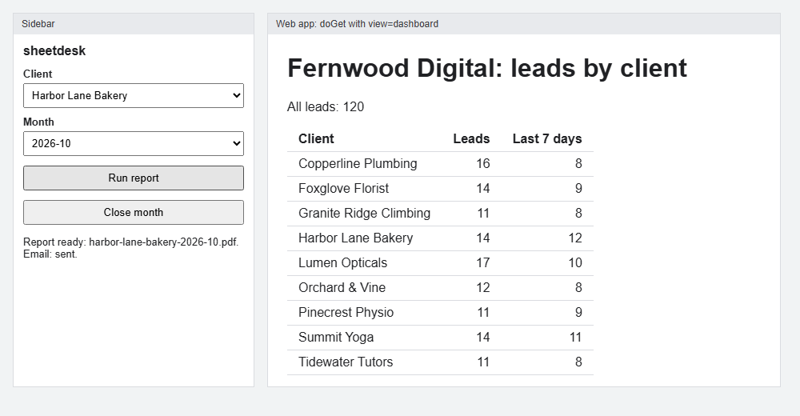
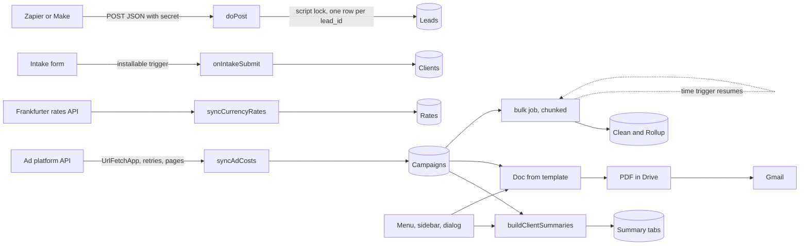

# sheetdesk

Google Apps Script tools that run a small marketing agency out of one Sheet.

[](https://github.com/Exalt24/sheetdesk/actions/workflows/ci.yml)



*The real sidebar and dashboard HTML in Chromium, filled with what the server functions return against the local fake ([script](scripts/screenshot.js)). Not Google's iframe.*

A made-up agency, Fernwood Digital, runs on it: nine invented clients, 2,024 generated campaign rows and 300 generated leads. 173 tests run against a local fake of Google's services. 100 mutants are all caught. A 50,000 row job finishes across 3 runs with no row lost or counted twice. The code has not run on a live Google account, see [Limits](#limits).

## What it is and why it exists

A small agency keeps its clients, campaign numbers and leads in Sheets. Each month the same chores eat hours: summing spend per client, building a report, mailing it, keeping lead forms and ad numbers in step. Apps Script can do all of that inside the Sheet. A script that works once when you click it is not a tool, though. Here each chore is a module that is safe to run twice, checks its input, and has tests.

Everything runs on invented data from a seeded generator. There are no real clients, no real people and no secrets in the repo.

## How it works



Apps Script loads every file in `src/` into one global scope, so the modules call each other by function name. A trailing underscore marks a private function, which `google.script.run` cannot call.

## The pieces

| Piece | What it does | Page |
|---|---|---|
| Summaries, PDFs, month close | One summary tab per client from one `getValues`. A monthly report built from a template Doc, exported to a PDF with a stable name (a rerun replaces it), and emailed. | [summaries-and-pdfs.md](docs/summaries-and-pdfs.md) |
| Menu, sidebar, dialog | `onOpen` menu, a sidebar with a client picker, a confirm dialog for the month close. Server functions check their input. | [menu-and-sidebar.md](docs/menu-and-sidebar.md) |
| Web app | `doPost` lead webhook with a shared secret, bad JSON and unknown field errors, one row per `lead_id` under a lock. `doGet` status JSON or an HTML dashboard. | [webhook.md](docs/webhook.md) |
| Intake form | An installable `onFormSubmit` trigger writes a client row and sends a confirmation. | [intake-form.md](docs/intake-form.md) |
| Ad costs and rates | A `UrlFetchApp` client with backoff, `Retry-After`, pagination and a response check. Pulls daily ad costs and USD rates. | [ad-and-fx.md](docs/ad-and-fx.md) |
| Scale | 50,000 rows in chunks, a time budget, a saved cursor and a continuation trigger. | [scale.md](docs/scale.md) |
| Fake and data | The local fake of Google's services, and the seeded generator behind every number here. | [fake-and-seed.md](docs/fake-and-seed.md) |

## Deploy with clasp

You need Node 22, a Google account and `clasp`. Nothing here has been deployed yet, so these are the documented steps, not a recorded run.

```bash
npm install -g @google/clasp
clasp login
clasp create --type sheets --title "sheetdesk" --rootDir src   # new Sheet with a bound script
clasp push                                                    # uploads src/ and the manifest
```

1. In the Sheet, reload and use **sheetdesk, Set up**. It creates the Campaigns, Clients, Leads and Rates tabs and saves a random webhook secret in the script properties.
2. Import `fixtures/clients.csv` and `fixtures/campaigns.csv` (`node scripts/seed.js` rewrites them) into the Clients and Campaigns tabs with File, Import, Replace data at selected cell.
3. Add `AD_API_KEY` in Project settings, Script properties, if you point the ad sync at an API. Run `installIntakeTrigger` once from the editor to authorise the script and create the form.
4. Deploy the web app and copy its URL:

```bash
clasp deploy --description "v1"
clasp deployments
```

The manifest in `src/appsscript.json` already asks for the web app to run as you and to accept anonymous callers, because Zapier and Make do not sign in with Google. The shared secret is the only gate.

In Zapier (Webhooks, POST, payload type JSON) or Make (HTTP, Make a request, JSON body), send the body shown in [webhook.md](docs/webhook.md) with your secret in the `secret` field.

Apps Script web apps cannot read request headers and cannot set an HTTP status code. The secret therefore travels in the body or in the URL, every reply is HTTP 200, and the caller must read `ok` in the JSON.

## Tests

```bash
npm install
npm test            # 173 tests
npm run lint        # ESLint, zero warnings allowed
npm run mutation    # 100 mutants, about 3 minutes
```

| Command | Result |
|---|---|
| `npm test` | 173 tests pass in about 4 seconds on Windows 11 with Node 24 |
| `npm run lint` | 0 errors, 0 warnings |
| `npm run mutation` | 100 mutants, 100 caught, 0 survived |

The tests load the files in `src/` into one `vm` context beside [a fake of the Google services](docs/fake-and-seed.md) written from Google's reference. The fake enforces the 6 minute limit, the lock rules, the 20 trigger limit and the quotas it knows. It also checks manifest scopes and the simple trigger restrictions. A few rules come from practice, such as `007` becoming 7 when a cell is set. Each rule has its own test.

- **Totals** are compared with an independent calculation (`referenceRollup` in `scripts/seed.js`) for every client and month of the generated agency.
- **Scale.** 50,000 generated rows, about 1 in 60 bad on purpose. The simulated clock charges 0.3 ms per cell read and 0.85 ms per cell written, chosen so the job needs more than one run. Result: 3 runs, 50,000 Clean rows with each source row once at its own row number, 49,166 valid rows counted once, and a 198 line rollup equal to the reference. At most one trigger existed at a time and none were left. The timings are simulated, real timings were not measured.
- **Kills.** 25 seeded worlds where each run is killed at a random service call about 4 times in 5. That is over 40 kills, and every world ends with every row once.
- **Webhook.** 25 random sequences of 40 requests must end with each accepted lead stored once. They mix wrong secrets, extra fields, lock contention and look-alike ids like `007` and `7`.
- **HTTP client.** The waits are asserted exactly (500, 1000, 2000, 4000 ms). 30 random fault sequences must end in data or a clear error.
- **Mutation.** `scripts/mutation.js` removes or flips one guard at a time and the suite must fail for each. The guards include the secret check, the lock, the idempotency check, the chunk cursor, the time budget, retry on 429, the PDF replace, the sidebar input checks and the formula guard, plus 91 more. The first run missed three. A test read the HTML from disk instead of from the loader. A flush was written twice, so neither copy was needed. And no test covered a job that finishes twice after a kill. All three are fixed.

## Limits

- **Tested against a local fake written from Google's documentation, not yet deployed or run on a live Google account.** The fake can differ from the real services in ways this repo cannot see. Behaviour the reference does not state is handled strictly in the fake, so it may refuse something the real service accepts.
- The PDF in the fake is text with a PDF header. Page layout, fonts and the real Doc to PDF conversion are untested.
- Apps Script quotas apply. One execution runs at most 6 minutes. A consumer account has 90 minutes of trigger runtime a day, 100 email recipients a day, 20,000 URL fetch calls a day and 20 triggers per script (Workspace accounts have more of the first three). The scale job keeps inside 6 minutes with a budget check, but its chunk size and budget are not tuned to real speeds.
- The Frankfurter reply shape was checked by hand with a few `curl` requests on 2026-11-10. The script has not called it. The ad platform is invented, and real platforms need OAuth, which is not built.
- The web app has no rate limit and one secret for every caller. A secret in a URL can end up in logs.
- The HTML was never rendered inside Google's iframe, and `google.script.run` was never called from a browser.
- No Looker Studio report yet.
- CI runs lint and tests on Linux. The mutation run is not in CI because it takes minutes.

## Stack

Google Apps Script (V8), clasp layout under `src/`, Node `node:test`, ESLint 9.

## License

MIT, see [LICENSE](LICENSE).
